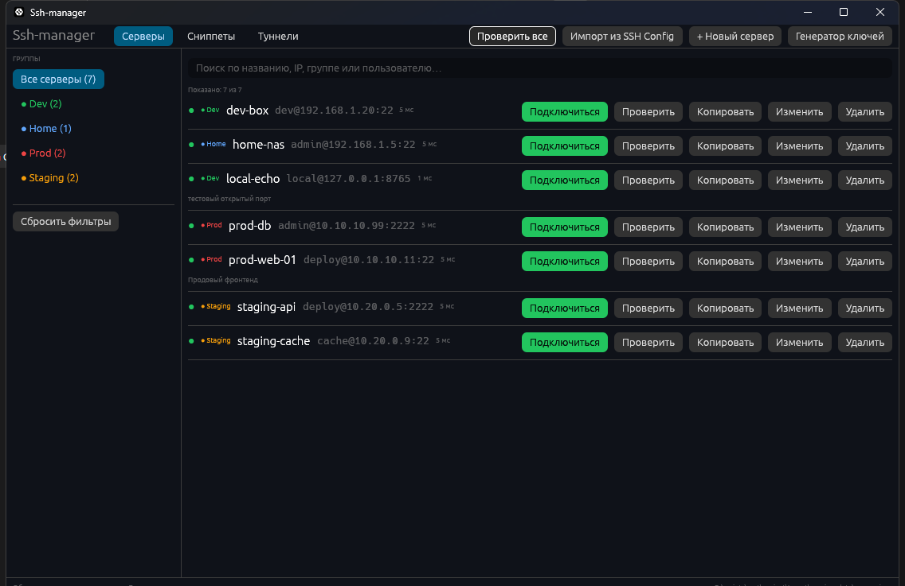
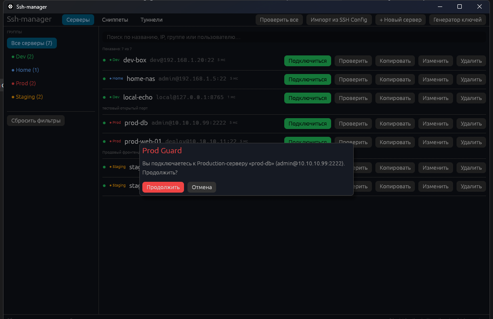
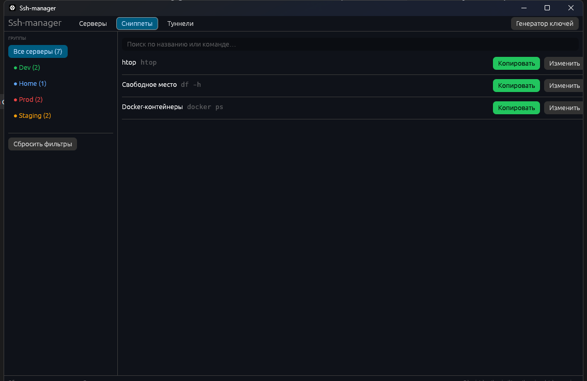
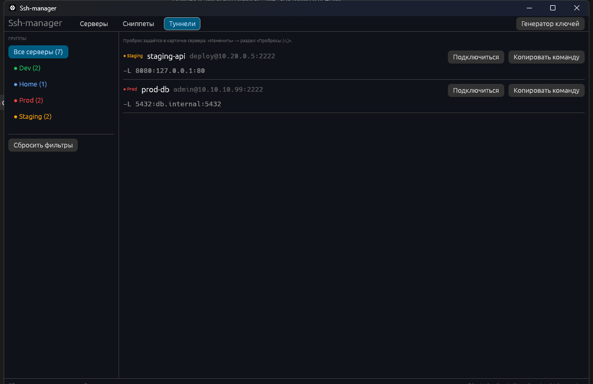
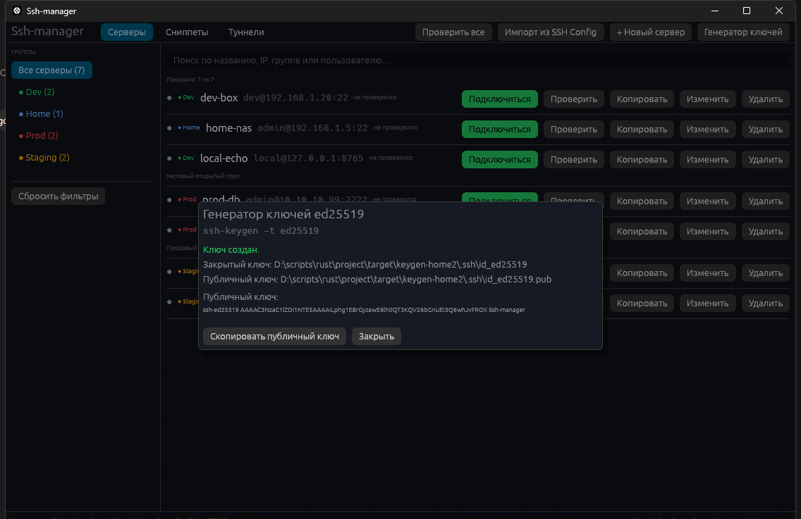

# Ssh-manager

**Современный десктопный SSH-менеджер для Windows на Rust + eframe (egui).**

Вдохновлён Termius, RustConn и Shellit: аккуратный список серверов с группами и цветами,
живой поиск, защита от случайного входа на прод, асинхронная проверка доступности,
сниппеты команд, локальные SSH-туннели и генератор ключей — всё в одном окне,
без браузера, аккаунтов и подписок.



## Скачать

Готовые сборки — на странице **[Releases](https://github.com/BEMOON863/ssh-manager/releases/latest)**:

| Файл | Что это |
|---|---|
| `Ssh-manager-Setup-0.1.0.exe` | Установщик: ставит приложение в `%LOCALAPPDATA%\Programs\Ssh-manager`, создаёт ярлык в меню «Пуск» и пункт удаления в «Программы и компоненты» |
| `Ssh-manager-0.1.0-windows-x64.zip` | Портативная версия: распаковать в любую папку и запустить `Ssh-manager.exe`; `servers.json` создастся рядом |

> Сборки не подписаны сертификатом, поэтому Windows SmartScreen может показать «Неизвестный издатель».
> Нажмите «Подробнее» → «Выполнить всё равно». Скачивайте файлы только со страницы Releases этого репозитория.

## Содержание

- [Скачать](#скачать)
- [Возможности](#возможности)
- [Требования](#требования)
- [Установка и запуск](#установка-и-запуск)
- [Быстрый старт](#быстрый-старт)
- [Подробнее о функциях](#подробнее-о-функциях)
- [Где хранятся данные](#где-хранятся-данные)
- [Безопасность](#безопасность)
- [Как это устроено](#как-это-устроено)
- [Разработка и проверки](#разработка-и-проверки)
- [Ограничения и FAQ](#ограничения-и-faq)
- [Планы развития](#планы-развития)
- [Лицензия](#лицензия)

## Возможности

### Серверы и группы

- Карточки серверов с полями: **название**, **группа/тег**, **хост/IP**, **порт** (по умолчанию 22),
  **пользователь**, **путь к SSH-ключу**, **Jump-хост** (опция `-J`) и **заметки**.
- Цветовая индикация групп: `Prod` — красный, `Staging` — янтарный, `Dev` — зелёный,
  `Home` — синий; группы с другими именами показываются нейтральным цветом.
- Левая панель с фильтром по группам и количеством серверов, включая «без группы».
- Живой поиск по названию, IP/хосту, тегу группы и пользователю.
- Сортировка списка по имени и хосту.

### Импорт из SSH Config

- Кнопка **«Импорт из SSH Config»** читает стандартный
  `%USERPROFILE%\.ssh\config` (OpenSSH, Windows 10/11).
- Понимает директивы `Host`, `HostName`, `User`, `Port`, `IdentityFile`, `ProxyJump`
  (регистр не важен, кавычки в значениях поддерживаются).
- Блоки `Host` с масками (`*`, `?`) и блоки `Match` пропускаются.
- Группу можно задать комментарием вида `# tag: Prod` перед или внутри блока.
- Перед импортом показывается превью со списком найденных хостов и чекбоксами;
  дубликаты (тот же хост + порт + пользователь) помечаются «уже есть» и не импортируются.

### Prod Guard

- Для серверов с группой `Prod` (регистр не важен) показывается красная метка.
- Перед подключением открывается модальное окно с предупреждением:
  **«Вы подключаетесь к Production-серверу … Продолжить?»**.
- Подтверждение требуется каждый раз — «запомнить» нельзя.



### TCP-проверка доступности

- Кнопки **«Проверить»** (один сервер) и **«Проверить все»**.
- Проверка выполняется в фоновых потоках и не блокирует интерфейс.
- Индикатор статуса: серый — не проверялся, янтарный — идёт проверка,
  зелёный — TCP-соединение установлено, красный — недоступен.
- Для зелёного статуса показывается время отклика в миллисекундах,
  для красного — причина в подсказке при наведении.
- Таймаут одного подключения — 3 секунды; результаты живут только в памяти.

### Сниппеты команд

- Отдельная вкладка с сохранёнными bash-командами (`htop`, `df -h`, `docker ps` и любые свои).
- При первом запуске добавляются три стартовых сниппета.
- Поиск по названию и содержимому, создание, редактирование и удаление.
- Кнопка **«Копировать»** кладёт команду в буфер обмена одним кликом.



### Конструктор SSH-туннелей

- Локальные пробросы `-L local_port:remote_host:remote_port` для любого сервера.
- Пробросы задаются прямо в карточке сервера (раздел «Пробросы (-L)»),
  количество — не ограничено.
- Вкладка **«Туннели»** показывает все пробросы по всем серверам,
  позволяет подключиться или скопировать готовую команду.



### Генератор ключей

- Окно **«Генератор ключей»** вызывает системный `ssh-keygen -t ed25519`.
- Можно задать путь и комментарий (`-C`); парольная фраза не задаётся.
- Существующие файлы не перезаписываются — приложение откажет с понятной ошибкой.
- После генерации показываются пути к ключам и публичный ключ,
  который можно скопировать кнопкой.



### Запуск сессии

- Кнопка **«Подключиться»** собирает полную команду
  `ssh [-p порт] [-i ключ] [-J jump] [-L ...] user@host`.
- Сессия открывается в **новом окне Windows Terminal** (`wt.exe -w -1 new-tab ssh …`);
  если Windows Terminal не найден — используется `cmd.exe /D /K`.
- Кнопка **«Копировать SSH-команду»** кладёт команду в буфер обмена
  (с корректными кавычками для путей с пробелами).
- Порт `22` в команду явно не добавляется — это поведение `ssh` по умолчанию.

## Требования

- **Windows 10/11** (x64). Приложение ориентировано на Windows:
  запуск терминала и генерация ключей используют `wt.exe`, `cmd.exe` и `ssh-keygen.exe`.
- **OpenSSH Client** — входит в Windows 10/11 по умолчанию
  (проверить: `ssh -V` и `ssh-keygen -V` в терминале).
- **Windows Terminal** — опционально; без него сессия откроется в `cmd.exe`.
- Для сборки из исходников: **Rust 1.95+** (проект собран на 1.99.1),
  toolchain MSVC (`rustup default stable-msvc`) и Visual Studio Build Tools
  с компонентом «Desktop development with C++» (нужен линковщик).
- Графический бэкенд — `wgpu` (по умолчанию в `eframe`); на очень старых GPU
  при необходимости можно пересобрать с бэкендом `glow` (см. раздел «Разработка»).

## Установка и запуск

### Из исходников

```powershell
git clone https://github.com/BEMOON863/ssh-manager.git
cd ssh-manager
cargo run
```

Первая сборка занимает несколько минут: скачиваются и компилируются зависимости
(eframe/egui/wgpu). Далее сборка инкрементальная.

### Release-сборка

```powershell
cargo build --release
```

Готовый бинарник: `target\release\Ssh-manager.exe`.
Его можно перенести в любую папку (например, `C:\Tools\Ssh-manager\`) и запускать двойным кликом.
Файл `servers.json` создастся рядом с `.exe`.

### Где лежит `servers.json`

| Способ запуска | Расположение данных |
|---|---|
| `cargo run` (debug) | `target\debug\servers.json` |
| `target\release\Ssh-manager.exe` | `target\release\servers.json` |
| Перенесённый `.exe` | рядом с `.exe` |
| Переменная окружения `AAA_DATA_DIR` | в указанном каталоге (полезно для тестов и переносимых сборок) |

Пример:

```powershell
$env:AAA_DATA_DIR = "D:\portable-ssh-manager"
.\Ssh-manager.exe
```

## Быстрый старт

1. Запустите приложение — при первом запуске создастся `servers.json` с тремя стартовыми сниппетами.
2. Нажмите **«+ Новый сервер»**, заполните название, хост, пользователя
   и (опционально) группу, ключ, jump-хост и заметки.
3. Нажмите **«Проверить»** или **«Проверить все»**, чтобы увидеть доступность серверов по TCP
   и время отклика.
4. Нажмите **«Подключиться»** — откроется новое окно Windows Terminal с SSH-сессией.
   Для серверов группы `Prod` нужно подтвердить подключение.
5. Если серверы уже описаны в `~/.ssh/config`, нажмите **«Импорт из SSH Config»**
   и отметьте нужные хосты в превью.

## Подробнее о функциях

### Карточка сервера

| Поле | Описание |
|---|---|
| Название | Отображается в списке; обязательно |
| Группа | `Prod`, `Staging`, `Dev`, `Home` или любое своё значение; кнопки-пресеты ускоряют ввод |
| Хост / IP | Имя или IP-адрес; обязательно |
| Порт | 1–65535, по умолчанию 22 |
| Пользователь | Если пусто — `ssh` использует текущего пользователя Windows |
| SSH-ключ | Путь к приватному ключу, уйдёт в `-i`; поддерживается `~/.ssh/id_ed25519` |
| Jump-хост | Промежуточный хост для `-J` |
| Заметки | Произвольный текст, виден в списке |

### Поиск и фильтрация

- Поиск ищет подстроку без учёта регистра по названию, хосту, группе и пользователю.
- Фильтр по группе и поиск работают одновременно.
- Кнопка **«Сбросить фильтры»** очищает и фильтр, и строку поиска.

### Prod Guard

Prod Guard включается ровно для группы с именем `prod` (без учёта регистра и пробелов по краям).
Группа `Production` защитой **не** считается — если нужен другой набор, задайте группу `Prod`.

### TCP-проверка

- Проверяется именно TCP-соединение с `host:port`, без SSH-аутентификации и без отправки данных.
- Каждая проверка — отдельный поток с таймаутом 3 секунды.
- Проверка не пишется в `servers.json`: после перезапуска статусы сбрасываются в «не проверялся».

### Сниппеты

- Команды копируются в буфер обмена как есть; они не выполняются приложением.
- Название и команда обязательны, пустые значения не сохраняются.

### Туннели

- Каждый проброс — отдельный аргумент `-L` в команде SSH.
- Туннели работают для любой сессии, в том числе с ключом и jump-хостом.
- Поддерживаются только локальные пробросы (`-L`); `-R` и `-D` пока не реализованы.

### Генерация ключей

- Используется системный `ssh-keygen` (OpenSSH для Windows).
- Команда: `ssh-keygen -t ed25519 -f <путь> -N "" -C <комментарий>`.
- Ключ создаётся без парольной фразы; если нужен ключ с паролем — сгенерируйте его
  вручную и укажите путь к нему в карточке сервера.

## Где хранятся данные

Вся конфигурация хранится в одном файле `servers.json` (UTF-8):

```json
{
  "version": 1,
  "servers": [
    {
      "id": 1,
      "name": "prod-web-01",
      "group": "Prod",
      "host": "10.10.10.11",
      "port": 22,
      "user": "deploy",
      "key_path": "C:\\Users\\me\\.ssh\\id_ed25519",
      "jump": "bastion.example.com",
      "notes": "Продовый фронтенд",
      "tunnels": [
        { "local_port": 8080, "remote_host": "127.0.0.1", "remote_port": 80 }
      ]
    }
  ],
  "snippets": [
    { "id": 1, "name": "htop", "command": "htop" }
  ]
}
```

- Запись атомарная: сначала `servers.json.tmp`, затем переименование.
- Если файл повреждён, приложение сделает резервную копию `servers.json.bak`
  и покажет предупреждение, не затирая данные молча.
- Недостающие поля при чтении заполняются значениями по умолчанию —
  файл от старой версии не сломает приложение.

## Безопасность

- Приложение **не хранит пароли** и не запрашивает их: аутентификация — по ключу,
  ввод пароля при необходимости происходит в самом терминале `ssh`.
- Парольная фраза для сгенерированных ключей не задаётся — такой ключ стоит
  дополнительно защитить средствами ОС (права на файл, BitLocker).
- `servers.json` — обычный текст: хосты, пользователи, пути к ключам и заметки
  видны любому, кто имеет доступ к файлу. Если это критично, храните файл
  в защищённой папке или в зашифрованном диске.
- Prod Guard снижает риск случайного входа на прод, но не заменяет
  разграничение прав на стороне серверов.
- Приложение не отправляет конфигурацию в сеть и не содержит телеметрии.

## Как это устроено

```
src/
├── main.rs              — запуск eframe, размер окна, заголовок «Ssh-manager»
├── app.rs               — ManagerApp: состояние, вкладки, модальные окна, действия,
│                          канал фоновых TCP-проверок, сохранение конфигурации
├── model.rs             — Server / Tunnel / Snippet / AppConfig, валидация, поиск, группы
├── store.rs             — чтение/атомарная запись servers.json, бэкап повреждённого файла
├── probe.rs             — TCP-проверка с таймаутом (connect_timeout, 3 с)
├── theme.rs             — тёмная тема и цвета групп
├── ssh/
│   ├── command.rs       — сборка ssh-команды (-p, -i, -J, -L), квотирование Windows
│   ├── launch.rs        — wt.exe → cmd.exe (fallback), флаги создания процесса
│   ├── config_import.rs — парсер %USERPROFILE%\.ssh\config
│   └── keygen.rs        — запуск ssh-keygen и проверка путей
└── ui/
    ├── servers.rs       — вкладка «Серверы»: поиск, панель групп, список, действия
    ├── editor.rs        — карточка сервера и пробросы
    ├── import.rs        — превью импорта с чекбоксами
    ├── snippets.rs      — вкладка «Сниппеты» и её форма
    ├── tunnels.rs       — вкладка «Туннели»
    ├── keygen.rs        — окно генератора ключей
    └── mod.rs           — бейджи групп, индикатор проверки, общие хелперы
```

**Поток работы:**

1. При старте `store::load()` читает `servers.json` (или создаёт файл с дефолтными сниппетами).
2. `eframe::App::ui` каждый кадр рисует панели (тулбар, группы, контент, статус-бар),
   а `logic` забирает результаты TCP-проверок из канала и обновляет статусы.
3. Действия пользователя (сохранить, удалить, импортировать, подключиться, скопировать)
   обрабатываются в `app.rs`; изменения конфигурации сразу пишутся в `servers.json`.
4. «Подключиться» собирает аргументы в `ssh::command`, затем `ssh::launch` запускает
   `wt.exe` (или `cmd.exe`) отдельным процессом.
5. Проверка доступности: `app` запускает поток на сервер, `probe::probe_host` делает
   `TcpStream::connect_timeout`, результат возвращается через `mpsc`, поток просит
   `Context::request_repaint`, и UI обновляется.

Проект разделён на библиотечный крейт `ssh_manager` и тонкий бинарник:
это упрощает юнит-тестирование логики без запуска окна.

## Разработка и проверки

```powershell
# форматирование, проверка типов и clippy с -D warnings
powershell -NoProfile -ExecutionPolicy Bypass -File .\scripts\verify.ps1

# юнит-тесты (48 тестов: парсер конфига, команды, хранилище, probe, keygen и др.)
cargo test --all-targets

# запуск приложения
cargo run
```

- `scripts/verify.ps1` последовательно выполняет `cargo fmt --check`,
  `cargo check --all-targets` и `cargo clippy --all-targets -- -D warnings`
  и останавливается на первой ошибке.
- Тесты используют каталог `target\test-data`; сеть и реальные SSH-серверы не нужны.
- Сборка установщика: нужен Inno Setup 6+, затем
  `ISCC.exe installer\setup.iss` (ожидает готовый `target\release\Ssh-manager.exe`);
  результат появится в `target\release\dist\Ssh-manager-Setup-0.1.0.exe`.
- Для сборки с OpenGL-бэкендом вместо wgpu: заменить в `Cargo.toml` зависимость
  `eframe = "0.37"` на `eframe = { version = "0.37", default-features = false, features = ["glow", "default_fonts", "clipboard", "system_fonts", "accesskit", "links"] }`.

## Ограничения и FAQ

**Поддерживаются только локальные туннели `-L`.** Обратные (`-R`) и динамические (`-D`)
пробросы пока не реализованы.

**Один jump-хост и один ключ на сервер.** Несколько `-J` подряд и цепочки ключей
не поддерживаются; при необходимости используйте промежуточный `~/.ssh/config`.

**IPv6-адреса не поддержаны** — используется формат `host:port`.

**Где вводится пароль?** В окне терминала, которое открывает приложение:
`ssh` сам спросит пароль или парольную фразу ключа. Приложение пароли не видит и не хранит.

**Почему в команде нет `-p 22`?** Для порта по умолчанию `-p` не добавляется;
для любого другого порта параметр появляется в команде.

**Windows Terminal не установлен.** Ничего страшного: сессия откроется в `cmd.exe`.
Если не находится и `ssh`, установите компонент «OpenSSH Client»
в «Параметры → Приложения → Дополнительные компоненты».

**«ssh-keygen завершился с ошибкой».** Проверьте, что `ssh-keygen` доступен в `PATH`
(`ssh-keygen -V` в терминале) и что у приложения есть права на запись в выбранный каталог.
Если приложение запущено внутри ограниченной песочницы (например, DSH),
`ssh-keygen` может не суметь создать `.pub` — запустите вне песочницы.

**Как сбросить все настройки?** Закройте приложение и удалите `servers.json`;
при следующем запуске он создастся заново со стартовыми сниппетами.

**Linux/macOS?** GUI соберётся, но запуск терминала (`wt.exe`/`cmd.exe`) и генерация
ключей (`ssh-keygen.exe`) написаны под Windows; на других ОС эти функции не заработают.

## Планы развития

- Обратные (`-R`) и динамические (`-D`) туннели.
- Поддержка парольной фразы при генерации ключа и выбор ключа через диалог файлов.
- Несколько jump-хостов и цепочки пробросов.
- Поддержка IPv6.
- Группы с пользовательскими цветами и произвольные теги.
- Экспорт/импорт конфигурации и опциональная синхронизация.
- Локализация интерфейса (русский/английский).

## Лицензия

Проект распространяется по лицензии **MIT** — см. [LICENSE](LICENSE).
